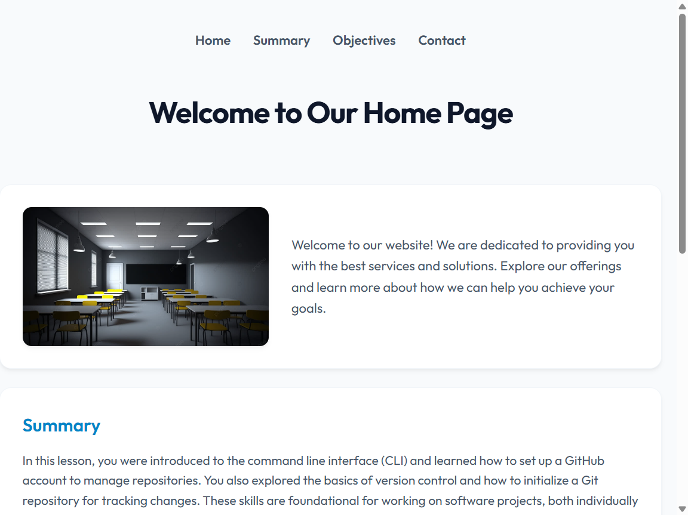
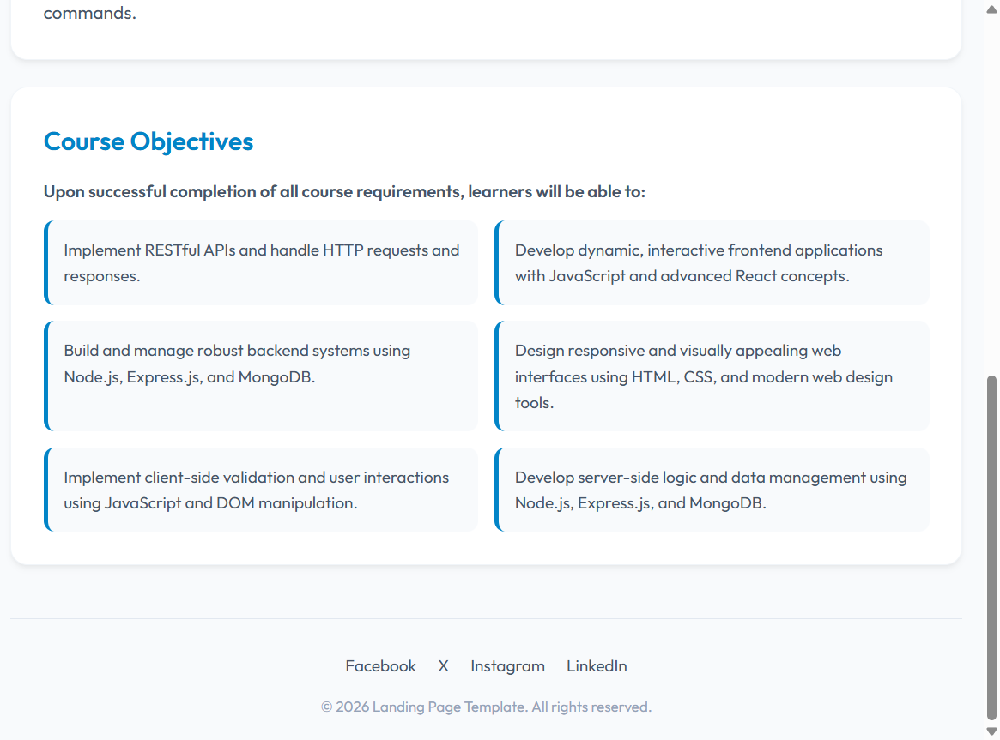

# Version Control Simulation

A one-page site about Git and the course objectives. `index.html` is the page. `styles.css` sets the layout, the Outfit font, and the blue headings. The browser tab title is **Course Objectives & Git Fundamentals**.

## Screenshots

**Top of the page.** The nav, the heading, the welcome card, and the start of the summary. The classroom photo loads from pngtree.



**Objectives and footer.** Six objectives sit in two columns. The footer links and the copyright line are under that card. The last words of the summary are still visible at the top because this shot is the bottom of the page.



## The page

The nav stays on this page:

| Link | Target |
| --- | --- |
| Home | `#welcome` |
| Summary | `#hero` |
| Objectives | `#features` |
| Contact | `#footer` |

Summary was clicked in the browser and the address became `index.html#hero`.

The welcome card places the photo on the left and this text on the right: "Welcome to our website! We are dedicated to providing you with the best services and solutions. Explore our offerings and learn more about how we can help you achieve your goals."

The summary describes setting up GitHub, the command line, and initializing a Git repository, then says the next lesson covers stage, commit, and tracking changes.

The objectives intro is "Upon successful completion of all course requirements, learners will be able to:" The six items are REST APIs, React frontends, a Node/Express/MongoDB backend, HTML and CSS interfaces, JavaScript validation, and server-side logic with the same backend stack.

The footer opens Facebook, X, Instagram, and LinkedIn in a new tab. The line under the links is `© 2026 Landing Page Template. All rights reserved.`

The page background is `#f8fafc`. Headings in the cards are `#0284c7`. Body text is `#0f172a`. On a nav link, the stylesheet turns the text blue and draws an underline. Cards lift slightly on hover, and an objective card shifts to the right. Below 768px the welcome photo stacks above its paragraph.

## How to open it

Open `index.html` in a browser, or serve this folder:

```bash
python -m http.server
```

The photo needs a network connection.

## Git history

Remote: `https://github.com/baldemoussa/version-control-simulation-MamadouMoussaBalde.git`

`main` tracks `origin/main`. `feature/header` and `feature/footer` still point at the commits from before the merge.

1. The first commit added the header and the main section.
2. `feature/footer` added the footer, then changed the lower list to a **Features** heading with three items: REST APIs, React, and a Node/Express/MongoDB backend.
3. `feature/header` changed that same list to **Course Objectives** with three other items: HTML/CSS interfaces, JavaScript validation, and server-side logic.
4. Commit `fix merge conflict` merged those two branches. The page kept the Course Objectives heading, added the sentence "learners will be able to", and kept all six list items.
5. A later commit added `styles.css`, the classroom photo, the in-page nav, and the heading "Welcome to Our Home Page".
6. Pull request **#1** is merged on `origin/review/main`. The merge message says the index update and the look and feel were approved.

# Reflection

1. **Branching Strategy:** Dedicated branches (`feature/header` and `feature/footer`) were created using `git branch`/`git checkout` to isolate changes and prevent team members from overwriting each other's work.
2. **Conflict Resolution:** A merge conflict in `index.html` was manually resolved by locating the Git conflict markers and combining the structural code changes from both branches.
3. **Pull Requests (PRs):** The PR workflow served as a quality check, allowing team members to review line-by-line changes, prevent broken layouts, and align on coding standards before code merged to the `main` branch.
